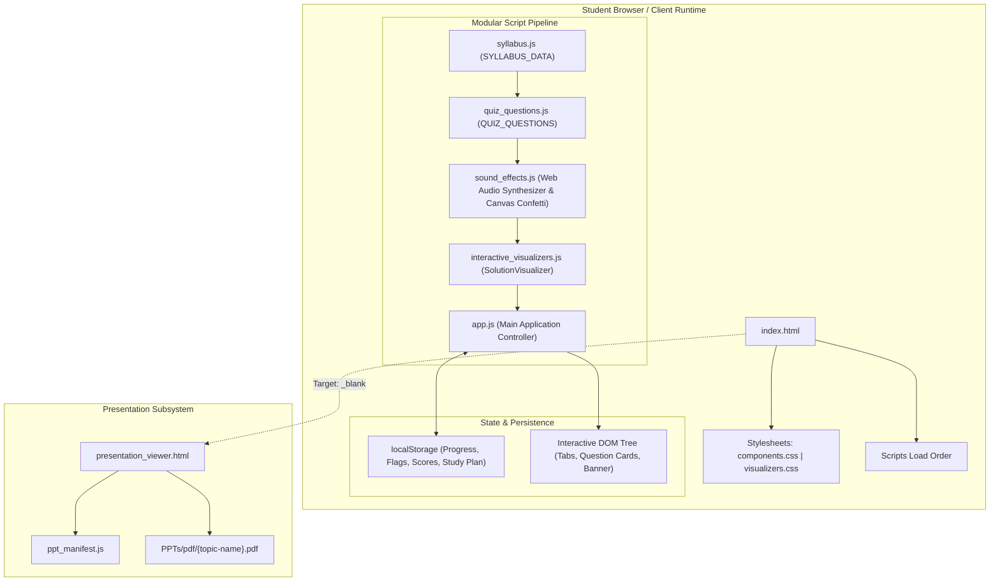

# 🏗️ ARCHITECTURE.md — System Architecture, Design System & Engineering Guide

This document is the authoritative engineering specification for the **NALR Masterclass** platform (**Numerical Aptitude & Logical Reasoning-I — Course Code: 25UNI0110**). It details system architecture, product requirements, design system tokens, visualizer construction standards, dataset schemas, and testing pipelines.

---

## 1. Product Scope & Curriculum Requirements

### 1.1 Executive Summary & Problem Statement
Undergraduate engineering students preparing for campus placements, competitive exams (CAT, GATE, GRE), and university sessional exams require more than static text answers. **NALR Masterclass** provides a zero-dependency, offline-capable, gamified, and deeply visualized practice platform. Every question across all syllabus topics features bespoke mathematical/logical diagrammatic visualizers, instant audio feedback, continuous examination simulation, in-browser slide presentations, and an algorithmic daily study planner.

### 1.2 Core Curriculum & Examination Scope

The platform is structured around the official 3-Term curriculum:

#### Term 1: Sessional Test 1 (ST-1) — 17 Modules (Active Bank: 753 Questions)
| Mod # | Module Name | Syllabus Track | Active Question Types & Subtabs | Total Questions |
| :---: | :--- | :--- | :--- | :---: |
| **mod1** | **Blood Relation** | Relational Logic | Family Tree (T1), Group Caselets (T2), Pointing & Dialogue (T3) | **34 Qs** |
| **mod2** | **Coded Relation** | Symbolic Logic | Forward Symbolic (T1), Target Equation (T2), Arithmetic Ops (T3), Reverse Coding (T4), Mixed Lineage (T5) | **18 Qs** |
| **mod3** | **Analogy** | Semantic & Num Equiv | Word Analogies (T1), Number Patterns (T2), Letter & Alphabet (T3) | **50 Qs** |
| **mod4** | **Direction Sense** | Spatial Geometry | Rotations & Clock Angles (T1), Pythagoras (T2), Relative Position (T3), Shadows (T4) | **38 Qs** |
| **mod5** | **Number System** | Number Theory | Unit Digits (T1), Factors & Primes (T2), Divisibility (T3), Digit Reversal (T4), Series Sum (T5), Extra Q (T6) | **77 Qs** |
| **mod6** | **H.C.F. & L.C.M.** | Arithmetic Foundations | Prime Factorization (T1), Real-World Tracks/Bells (T2), Remainder Models (T3), Product/Ratio (T4), Extra Q (T5) | **52 Qs** |
| **mod7** | **Average** | Balance Mechanics | Arithmetic Mean (T1), Inclusion/Exclusion (T2), Weighted/Alligation (T3), Cricket (T4), Speed (T5), Demographics (T6), Extra Q (T7) | **58 Qs** |
| **mod8** | **Remainder Theorem** | Modular Arithmetic | Positive Num (T1), Negative Num (T2), Operations (T3), Factorials (T4), Unit/Last Two (T5), Simplification (T6), Power Forms (T7), Fermat/Wilson (T8), Next Power (T9), Algebraic (T10) | **55 Qs** |
| **mod9** | **Ratio & Proportion** | Quantitative Relations | Proportionals (T1), Coin Bags (T2), Mixtures/Dilutions (T3), Income/Expenditure (T4) | **28 Qs** |
| **mod10** | **Ages** | Linear Relations | Ratio Shifts (T1), Sum/Difference (T2), Age Products (T3), Multi-Person (T4) | **26 Qs** |
| **mod11** | **Partnership** | Commercial Arithmetic | Simple/Compound Capital (T1), Time Inversion (T2), Working Partners (T3) | **18 Qs** |
| **mod12** | **Allegation** | Mixture Mechanics | Alligation Cross (T1), Commercial Mixtures (T2), Liquid Concentration (T3), Successive Replacement (T4) | **25 Qs** |
| **mod13** | **Odd One Out** | Anomaly Detection | Single Letters (T1), Pairs (T2), Triplets & Letter Sets (T3) | **27 Qs** |
| **mod14** | **Syllogism** | Deductive Logic | Direct Deductions (T1), Either-Or Pairs (T2), Multi-Premise Chains (T3), Hybrid Either-Or (T4) | **25 Qs** |
| **mod15** | **FA1 Questions** | FA-1 Revision Set | Blood Relation (T1), Coded Relation (T2), Direction (T3) | **38 Qs** |
| **mod16** | **ST1 Questions** | ST-1 Revision Set | Number System (T1), H.C.F. & L.C.M. (T2), Average (T3), Remainder Theorem (T4) | **112 Qs** |
| **mod17** | **FA2 Questions** | FA-2 Revision Set | Ratio & Proportion (T1), Syllogism (T2) | **72 Qs** |

#### Term 2: Sessional Test 2 (ST-2) — 11 Modules
Covers: `st2_mod1` Percentage (34 Qs active), `st2_mod4` Coding-Decoding (23 Qs active), Profit & Loss, Simple & Compound Interest, Time & Work, Pipes & Cisterns, Speed Time & Distance, Trains, Boats & Streams, Clocks, Calendars, Permutations & Combinations.

#### Term 3: End Term Examination — 14 Modules
Covers comprehensive quantitative aptitude, data interpretation, probability, geometry, and applied verbal grammar.

---

## 2. High-Level Architectural Overview

The application follows an **Offline-First, Zero-Build Modular Vanilla Web Architecture**:



---

## 3. Script Load Order & Execution Lifecycle

The scripts load sequentially in `index.html` to satisfy dependencies without any bundler:

```html
<!-- Modular Load Order (Critical Dependency Order) -->
<script src="syllabus.js?v=18.0"></script>
<script src="quiz_questions.js?v=18.0"></script>
<script src="sound_effects.js?v=18.0"></script>
<script src="interactive_visualizers.js?v=18.0"></script>
<script src="app.js?v=18.0"></script>
```

1. **`syllabus.js`**: Declares global `SYLLABUS_DATA` and `SYLLABUS_MODULES`. Defines all terms (ST1, ST2, EndTerm) and subtab types.
2. **`quiz_questions.js`**: Declares global `QUIZ_QUESTIONS` array (810 verified questions across terms).
3. **`sound_effects.js`**: Instantiates synthetic Web Audio API tone oscillators for correct chime and incorrect buzz, plus canvas celebration confetti (`ConfettiManager`). Zero external MP3/WAV files required.
4. **`interactive_visualizers.js`**: Exposes the `SolutionVisualizer` namespace containing custom rendering algorithms for all syllabus topics.
5. **`app.js`**: Main event bus and application controller. Initializes state, binds DOM events, manages question rendering, calculates scores, and persists progress.

---

## 4. State Management & Persistence (`app.js`)

Application state is maintained in-memory and synchronized to `localStorage`:

```javascript
let currentTermId = 'st1';             // 'st1' | 'st2' | 'endterm'
let activeModuleId = 'mod1';           // Current syllabus module
let activeTypeId = 'type_1';           // Current problem-solving subtab
let activeDiffFilter = 'all';          // 'all' | 'Easy' | 'Medium' | 'Hard'
let filterFlaggedOnly = false;         // Boolean toggle for bookmarks
let userAnswers = {};                  // { [questionId]: selectedOptionText }
let flaggedQuestions = new Set();      // Set of bookmarked question IDs
let isExamMode = false;                // Practice Mode vs Continuous Exam Mode
let userStudyPlan = null;              // Personalized daily study schedule
```

### Persistence Keys (`localStorage`):
- `NALR_MULTI_TERM_APTITUDE_V8`: Practice answers, exam state, bookmarks, current term.
- `nalr_study_plan_v1`: JSON object storing `userStudyPlan` (target exam date, daily tasks, completed checkboxes).
- `nalr_theme`: String `'light'` or `'dark'`.

---

## 5. Design System, Theming & Motion Tokens

The platform pairs an Apple frosted-glass aesthetic with a warm neutral sand palette.

### 5.1 Color & Surface Tokens (`components.css`)
```css
:root {
  --bg: #f7f4ed;                       /* Sand Canvas Background */
  --card-bg: #fffdfa;                  /* Primary Card Background */
  --card-sub-bg: #f3ede2;              /* Secondary Surface */
  --ink-primary: #1f1b18;              /* Main Typography Ink */
  --ink-secondary: #5c554e;            /* Explanations & Captions */
  --ink-muted: #8a8278;                /* Metadata & Sub-labels */
  --border-color: #dcd1be;             /* Structural Border */
  --primary-blue: #2563eb;             /* Royal Blue Accent */
  --emerald-green: #15803d;            /* Verified Correct State */
  --crimson-red: #b91c1c;              /* Incorrect Answer State */
  --amber-gold: #b45309;               /* Flagged / Star State */
  --purple-accent: #7c3aed;            /* Lecture Notes Accent */
}

[data-theme="dark"] {
  --bg: #07090e;                       /* Obsidian Canvas Background */
  --card-bg: #0e1422;                  /* Midnight Card Surface */
  --card-sub-bg: #141c2e;              /* Deep Slate Navy */
  --ink-primary: #f8fafc;              /* Bright Text */
  --ink-secondary: #94a3b8;            /* Slate Secondary */
  --border-color: rgba(255, 255, 255, 0.1);
  --primary-blue: #3b82f6;
  --emerald-green: #3ecf8e;
  --crimson-red: #f87171;
}
```

### 5.2 Motion & Acceleration Standards
- **Zero-Repaint Fixed Background**: Background planes decoupled via `body::before` with `transform: translateZ(0)` and `will-change: transform`.
- **Micro-Interactions**: Button resets with tactile spring press (`transform: translateY(-1px)`, active: `scale(0.985)`).
- **CSS Grid Drawers**: Smooth zero-jank expand/collapse via `grid-template-rows: 0fr -> 1fr`.
- **Specular Rim Lighting**: Tactile top border highlight via `inset 0 1px 0 0 rgba(255,255,255,0.95)` in light mode, `0.12` in dark mode.

---

## 6. Solution Visualizer Construction Standards

When creating or modifying visualizers in `interactive_visualizers.js`:
1. **Never Render Plain Text Fallbacks for Active Topics**: Every active topic must feature dedicated diagrammatic SVG or interactive HTML models.
2. **Container Format**:
   ```html
   <div class="sol-vis-container vis-{topic}">
     <div class="vis-badge-header">
       <span class="vis-icon">{Emoji}</span>
       <span class="vis-label">{Technical Model Name}</span>
       <span class="vis-module-tag">{Topic Tag}</span>
     </div>
     <!-- Dynamic Diagrammatic Visual Content -->
     <div class="vis-resolution-banner">
       <!-- Golden resolution banner highlighting correct answer -->
     </div>
   </div>
   ```
3. **XSS Protection**: Always escape dynamic question and option strings using `escape(q.correct)`.

---

## 7. Multi-Term Dataset & Question Integration Guide

### 7.1 Question Schema (`quiz_questions.js`)
```javascript
{
  id: "mod{num}_q{index}",              // e.g. "mod5_q12" or "st2_mod1_q1"
  module_id: "mod{num}",                // Must match module ID in syllabus.js
  module_name: "Exact Title",           // e.g. "Number System"
  syllabus_lec: "Lecture Subtitle",     // e.g. "ST-1 Number Theory"
  type_id: "type_{x}",                  // Must match a registered type in syllabus.js
  type_name: "Type X: Problem Title",   // Exact type display name
  difficulty: "Easy" | "Medium" | "Hard",
  points: 1,                            // Integer mark weight
  question: "Full problem statement...",// Clean string
  options: [ "Opt A", "Opt B", "Opt C", "Opt D" ],
  correct: "Exact matching option text",// Must match one item in options array!
  explanation: "Step-by-step detailed solution text..."
}
```

### 7.2 Syllabus Schema (`syllabus.js`)
- Structured under `SYLLABUS_DATA.st1`, `SYLLABUS_DATA.st2`, `SYLLABUS_DATA.endterm`.
- Each module specifies `id`, `num`, `title`, `lectures`, `desc`, and `types: [...]`.
- The `count` property of each type in `syllabus.js` MUST strictly match the number of questions in `quiz_questions.js` bearing that `type_id`.

---

## 8. Automated Verification & Testing Pipelines

To guarantee zero runtime regressions, the repository includes two automated test suites:

### 8.1 Dataset & Synchronicity Audit (`verify_dataset.py`)
Run the Python validation CLI:
```bash
python verify_dataset.py
```
Audits:
- Schema validation of all question objects.
- Correct answer presence in options array.
- Unique ID invariants across all 810+ questions.
- Synchronicity between `syllabus.js` subtab counts and actual question counts.

### 8.2 Comprehensive Requirements & Visualizer Audit (`scratch/test_all_requirements.js`)
Run the Node.js test harness:
```bash
node scratch/test_all_requirements.js
```
Audits:
- Syllabus badges and module counts.
- `PPT_MANIFEST` synchronization and disk file presence.
- Visualizer generation and SVG container integrity.
- Full answer key verification.
